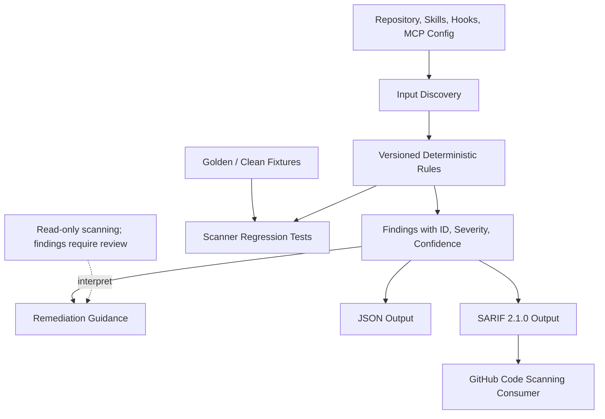

# x4-ai-security-scanner

[](https://github.com/dhe-cruzer69/x4-ai-security-scanner/actions)
[](LICENSE)

**Security scanner for agent repos, skills, hooks, and MCP configs.**

Deterministic rules first. Transparent findings with severity, confidence, and remediation. SARIF for GitHub code scanning.

## Quick start

```bash
pip install -e ".[dev]"
x4-sec scan .
x4-sec scan --json
x4-sec scan --sarif results.sarif
```

## What it scans

- `.claude/`, `.cursor/`, hooks
- `mcp.json` / `mcp.yaml`
- `SKILL.md`, `CLAUDE.md`, `AGENTS.md`
- Scripts, Dockerfiles, lockfiles, env samples

## Design

- Rule engine with explicit IDs (e.g. `X4-CRED-001`)
- No inflated "40,000 patterns" claims — rules are versioned and listed
- Default-deny mindset for unknown high-risk surfaces
- Read-only CI permissions

<!-- X4-APEX-DIAGRAM-START:x4-ai-security-scanner -->



<!-- X4-APEX-DIAGRAM-END:x4-ai-security-scanner -->

## License

Apache-2.0
